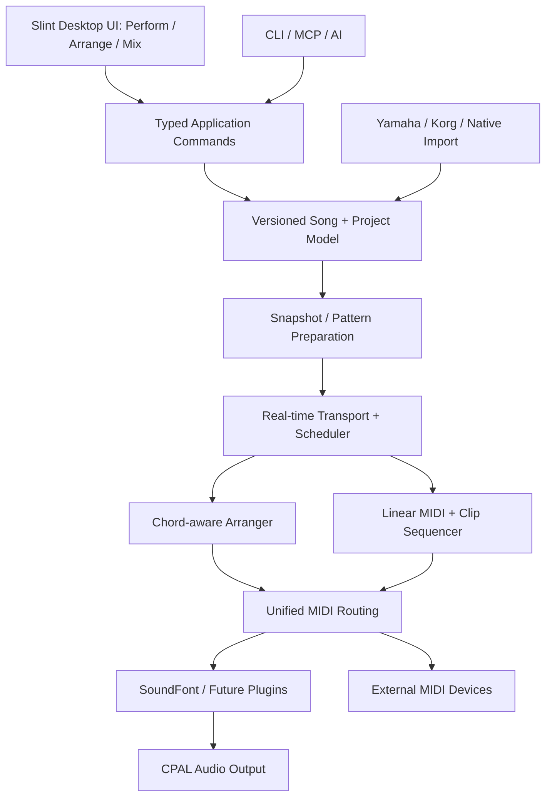

# Lazy Arranger Rust v2 — Architecture & Build Blueprint

**Status:** Initial engineering blueprint / working specification  
**Targets:** Windows and macOS  
**Product:** MIDI-first arranger DAW for live performance and studio production  
**Source application:** https://github.com/nhth-mibu/arranger-midi-daw  
**References:** https://github.com/Pep3M/cadenza, https://github.com/alexanderwanyoike/vibez, https://github.com/storytold/soundcraft and https://github.com/kjmcnamara1/cecilia

> This document consolidates the design discussion. Repository capabilities and implementation details described below are **candidates to verify against source**, not a completed source-level audit. Do not assume a crate, API, license, or device command works without checking the current upstream source and documentation.

## 1. Vision

Build a second-generation Rust implementation of Lazy Arranger that combines:

- **Existing C++ Lazy Arranger:** musical behavior, Yamaha-style compatibility, device profiles, editing workflows, existing project compatibility, tests and AI/MCP concepts where present.
- **Cadenza:** ideas for modular DAW/audio architecture, plugin hosting, command-driven editing and AI/MCP integration.
- **Vibez:** Perform → Arrange → Mix workflow, live capture, quantized launches and clip-oriented editing.
- **New Rust design:** deterministic real-time scheduling, explicit ownership, independent music domain, strong testability, cross-platform UI.

**Do not port C++ line by line or fork another DAW by default.** Preserve proven behavior while selectively redesigning architecture. Treat the C++ implementation as a behavioral oracle for regression tests.

### Defining product behavior

A live performance must be recorded in **two linked representations**:
1. **Musical intent:** chord changes, style/section selection, fills, variations, tempo, transport and automation.
2. **Rendered performance:** timestamped MIDI notes/controllers (and eventually audio).

Users can edit intent and regenerate accompaniment, or detach/freeze generated MIDI for manual editing. Define how regeneration handles manually edited notes (e.g., regenerate untouched lanes only, or explicit replace/keep/duplicate choice).

## 2. Goals and non-goals

### Goals

- Play and edit Yamaha-style accompaniment with chord-aware conversion.
- Support both software-generated accompaniment and external arranger-keyboard integration.
- Build a shared transport for live arranger, linear sequencer and clip/performance workflows.
- Import existing project data and selected Yamaha styles; export Standard MIDI Files.
- Provide internal SoundFont playback and hardware MIDI routing.
- Run on Windows and macOS, including physical MIDI devices.
- Make all edits go through typed commands with validation, undo/redo and eventual AI/MCP access.
- Prepare architecture for Korg Pa, VST3/CLAP, audio tracks and notation without requiring them in first MVP.

### Explicit MVP exclusions

- Full Korg Pa native style import/export (research track, later milestone).
- Full VST3/CLAP hosting, plugin GUI embedding and plugin scanning.
- Full multitrack audio recording/editing, time stretching, waveform editing and advanced mixing.
- Universal remote control of proprietary Yamaha/Korg arranger functions.
- Guaranteed bit-for-bit parity with all C++ output before defining a compatible subset.

## 3. Source audit before implementation

Inspect the actual repositories and document evidence with file paths, symbols and commit SHAs.

| Repository | Audit focus | Decision required |
|---|---|---|
| Lazy Arranger C++ | Song/project model, style parser, CASM, chord conversion, scheduling, device profiles, notation, tests, AI/MCP, UI | Keep behavior / port / redesign / defer |
| Cadenza | Audio graph, RT thread, plugins, commands, undo, MCP, persistence | Design reference or code reuse? |
| Vibez | Perform/Arrange/Mix, capture, quantization, clips, UI rendering | UX and data-model ideas |

**Audit deliverables:** `docs/audit/source-inventory.md`, `docs/audit/feature-matrix.md`, `docs/audit/compatibility-baseline.md`, `docs/audit/licensing.md`.

Check actual LICENSE files and dependency licenses before copying code. A project's architecture can inspire implementation without importing source. Avoid assuming previously discussed GPL status is correct without verification.

## 4. Architecture principles

1. **Music model independent of platform:** no Slint, CPAL or hardware types in music/arranger crates.
2. **Single master transport:** audio sample timeline for deterministic internal playback; musical beat/tick timeline for editing.
3. **One command path:** GUI, shortcuts, automation, CLI, AI and MCP dispatch the same validated commands.
4. **Prepared immutable playback state:** edit on control thread; compile and atomically publish snapshots to real-time engine at safe boundaries.
5. **Real-time safe:** no allocation, blocking locks, disk I/O or potentially blocking logs inside audio callback.
6. **Manufacturer-neutral core, loss-aware adapters:** Yamaha CASM and Korg-specific data must not be flattened away.
7. **Testable headless:** core, arranger, scheduler, importers and project migration run without a GUI or audio device.
8. **Compatibility over accidental rewrite:** golden MIDI tests compare C++ and Rust using identical inputs.

### Conceptual flow



The exact RT scheduling ownership must be settled during the spike: avoid circular calls and ensure a single deterministic event ordering policy.

## 5. Proposed Rust workspace

Start with a **moderate number of crates**, split further only when boundaries are proven.

```text
lazy-arranger-rs/
├── Cargo.toml
├── apps/
│   ├── desktop/            # Slint desktop shell
│   └── cli/                # Headless import, render, diagnostics
├── crates/
│   ├── music-core/         # Chords, pitches, tempo, ticks, theory
│   ├── project/            # Songs, tracks, clips, style refs, serialization
│   ├── arranger/           # Chord recognition, style playback, transitions
│   ├── style-formats/      # Native + Yamaha SFF1/SFF2; future Korg
│   ├── sequencer/          # Transport, MIDI scheduling, clip capture
│   ├── audio-engine/       # CPAL, rustysynth, routing/mixing
│   ├── midi-devices/       # midir, SysEx, device capability profiles
│   └── app-commands/       # Validation, edits, undo/redo, snapshot build
├── tests/
│   ├── fixtures/
│   ├── golden/
│   ├── timing/
│   └── integration/
└── docs/
    ├── adr/
    └── audit/
```

Future optional crates: `plugin-host`, `notation`, `mcp-server`, `ai-services`, `audio-analysis`, `korg-import`.

## 6. Candidate dependencies

| Need | Candidate | Decision notes |
|---|---|---|
| Desktop UI | `slint` | Preferred starting hypothesis; prototype complex editors against `iced` and `egui` |
| MIDI ports | `midir` | Validate timestamp behavior, SysEx support and OS backends |
| MIDI files | `midly` | Import/export SMF; preserve timing and metadata |
| Audio device | `cpal` | Probe Windows/macOS backend behavior and supported buffers |
| SoundFont | `rustysynth` | Check audio callback allocation and performance before direct RT use |
| SPSC queues | `rtrb` | Bounded command/event queues |
| Persistence | `serde` plus versioned file schema | Explicit migrations and schema version |
| Audio decoding | `symphonia` | Post-MVP |
| WAV export | `hound` | Offline bounce/prototyping |
| VST3/CLAP | Evaluate Cadenza/Vibez implementations and independent host crates | Post-MVP; assess licensing and RT safety |
| Custom rendering | Slint custom renderer, possibly Vello | Benchmark piano roll and score rendering first |

Do not treat `nice-plug`/`nih-plug` (primarily plugin authoring frameworks) as automatic solutions to **hosting** third-party plugins.

## 7. Core domain model and API sketches

The snippets are **interface sketches**, not compilable complete modules.

### 7.1 Musical primitives

```rust
pub type Tick = i64;
pub type SamplePosition = i64;
pub const PPQ: Tick = 960;

#[derive(Clone, Copy, Debug, PartialEq, Eq)]
pub struct Chord {
    pub root_pc: u8,          // 0..11, pitch class
    pub quality: ChordQuality,
    pub bass_pc: Option<u8>,  // slash-chord pitch class
}

#[derive(Clone, Copy, Debug, PartialEq, Eq)]
pub enum ChordQuality {
    Major, Minor, Dominant7, Major7, Minor7,
    Diminished, Augmented, Suspended4,
}
```

Plan a richer extensible chord vocabulary, chord-detection ambiguity policies, no-chord and inversion/fingering modes. Keep display names separate from pitch-class representation.

### 7.2 Song and arranger intent

```rust
pub struct Song {
    pub tempo_map: TempoMap,
    pub tracks: Vec<Track>,
    pub chord_events: Vec<ChordEvent>,
    pub arranger_events: Vec<ArrangerEvent>,
}

pub struct ChordEvent {
    pub tick: Tick,
    pub chord: Chord,
}

pub enum ArrangerEvent {
    SelectStyle { tick: Tick, style_id: StyleId },
    SelectVariation { tick: Tick, variation: u8 },
    TriggerFill { tick: Tick, fill: u8 },
    Start { tick: Tick },
    Stop { tick: Tick },
}
```

Use typed stable IDs for tracks, clips, styles and device ports. Track provenance of generated MIDI and its relationship to intent events. Ensure old project import maps to this schema without losing unknown metadata.

### 7.3 Arranger engine

```rust
pub trait ArrangerEngine {
    fn load_style(&mut self, style: PreparedStyle);
    fn set_chord(&mut self, chord: Chord);
    fn request_section(&mut self, section: SectionId, mode: TransitionMode);
    fn process(&mut self, start: Tick, end: Tick, output: &mut dyn MidiEventSink);
}

pub enum TransitionMode { Immediate, NextBeat, NextBar, EndOfSection }
```

Implementation modules: `chord_detector`, `style_player`, `note_transformer`, `transition_manager`, `arranger_recorder`. Clarify fill precedence, late chord events, note-off ownership and transitions before implementation.

### 7.4 Sequencer / clock

```rust
pub trait Sequencer {
    fn play(&mut self);
    fn stop(&mut self);
    fn seek(&mut self, tick: Tick);
    fn process_block(
        &mut self,
        start_sample: SamplePosition,
        frames: usize,
        output: &mut dyn EventBuffer,
    );
}
```

Project timing uses 960 PPQ by default; internally use a high-precision tempo map and sample offsets. Define rounding rules, tempo ramps, loops, time signatures and stable ordering for simultaneous note-off/note-on events. Do not schedule playback from the GUI thread.

### 7.5 Hardware adapters

```rust
pub trait KeyboardAdapter {
    fn capabilities(&self) -> DeviceCapabilities;
    fn handle_input(&mut self, message: MidiMessage);
    fn handle_command(&mut self, command: KeyboardCommand)
        -> Result<(), DeviceError>;
}

pub enum KeyboardCommand {
    Start, Stop, SetTempo(f64),
    SelectStyle(StyleId),
    SelectVariation(u8),
    TriggerFill(u8),
}
```

These are **desired application commands**, not universal MIDI messages. Device profiles must advertise support, channel mapping, SysEx implementation and fallback behavior. Distinguish using a keyboard as a tone generator from remotely controlling its internal arranger.

### 7.6 Commands and undo

Suggested command boundary:

```rust
pub trait CommandHandler {
    fn apply(&mut self, command: AppCommand)
        -> Result<CommandOutcome, CommandError>;
    fn undo(&mut self) -> Result<(), CommandError>;
    fn redo(&mut self) -> Result<(), CommandError>;
}
```

Commands should be serializable where safe, carry stable IDs and produce changes that can be validated and replayed. AI/MCP proposals should preview and require approval for destructive edits. The RT callback never executes arbitrary application commands.

## 8. Style-format strategy

Use **native canonical style data** with manufacturer-specific extensions and import diagnostics.

```rust
pub struct Style {
    pub id: StyleId,
    pub name: String,
    pub sections: Vec<StyleSection>,
    pub metadata: StyleMetadata,
}

pub enum StyleMetadata {
    Native,
    Yamaha(YamahaMetadata),
    Korg(KorgMetadata),
}
```

### Yamaha

- Audit existing SFF1/SFF2 and CASM implementation in C++.
- Preserve source chord, NTR/NTT, note limits, retrigger and relevant controller behavior.
- Import a **tested subset** first; validate using known input/output fixtures.
- Provide warnings for unknown chunks, unsupported conversion rules and lossy exports.

### Korg Pa

- Investigate actual model/firmware formats and legally available test files.
- Model Korg chord variations and style elements separately from Yamaha CASM.
- Do not equate generic MIDI pattern import with native Pa-style compatibility.
- Deliver a documented compatibility matrix per keyboard family and format.

### Native style format

- Versioned schema with explicit sections, source patterns, chord conversion, voice/instrument routing and manufacturer extensions.
- Preserve raw unknown source metadata when legally and technically possible.
- Add an import report: `complete`, `partial`, `unsupported`, with detailed warnings.

## 9. Performance, Arrange and Mix workflow

### Perform

- Live chord input, split/fingering modes, style/variation/fill controls.
- Quantized transitions and optional clip/scene launch.
- Hardware or software sound destinations, synchronized by a shared transport.
- Record **both** intent events and actual MIDI output.

### Arrange

- Linear song timeline with chord lane, arranger lane, MIDI tracks and future audio lanes.
- Edit intent, regenerate MIDI, freeze or detach generated clips.
- Piano roll, markers, tempo map and section arrangement.

### Mix

- Start with MIDI routing, instrument selection, basic levels and SoundFont playback.
- Add audio tracks, buses, plugin hosting, automation and advanced mixer later.

## 10. Real-time execution model

**UI thread:** Slint rendering, user actions, editing.  
**Control/preparation worker:** project commands, file parsing, style preparation, immutable snapshots, background analysis.  
**Audio callback:** deterministic sample clock, event scheduling, prepared arranger patterns, synthesis and mixing.  
**MIDI dispatch worker:** bounded/timestamped output scheduling for physical ports.

Use bounded lock-free queues and defined overflow behavior. No callback allocations, locks, disk I/O or unbounded work. Preallocate event buffers and verify third-party synthesis behavior. External MIDI timing has OS/device jitter and cannot be assumed sample-accurate merely because internal scheduling is.

Suggested initial test configuration: 48 kHz, 128–256 frame buffers where supported; test higher/lower buffers and device disconnect/reconnect. Define latency and jitter budgets during the RT spike rather than promising unsupported figures.

## 11. Compatibility and test strategy

- Capture C++ golden outputs from representative chord/style/transition scenarios.
- Run equivalent Rust inputs and compare MIDI semantics and timing within explicit tolerances.
- Test chord quality, inversion, slash bass, source-to-target transposition and voice-leading.
- Test fill/variation transitions, tempo changes, loops, start/stop/seek and stuck-note cleanup.
- Round-trip SMF and project migration tests.
- Test manufacturer-style import diagnostics and partial compatibility.
- Benchmark audio callback execution time, allocations, event-buffer overflow and MIDI jitter.
- Smoke-test real keyboards on Windows and macOS, including port reconnection.
- Preserve legally usable fixtures and record expected outputs plus provenance.

## 12. Migration plan and gates

| Stage | Deliverable | Exit gate |
|---|---|---|
| 0. Source audit | Feature matrix, dependency inventory, licenses, C++ test baseline | Known behavior and selected parity scope |
| 1. Headless core | Workspace, music primitives, project schema, CLI | Unit tests and basic project import |
| 2. MIDI + transport | Device discovery, record/playback, SMF I/O | Stable multitrack MIDI playback on both OSes |
| 3. Arranger | Native styles, chord conversion, sections, fills | Golden test parity for chosen C++ cases |
| 4. Yamaha import | SFF1 and selected SFF2/CASM features | Reference styles play with validated output |
| 5. Live capture | Dual intent/rendered MIDI capture and regeneration | Recorded performance can be edited and replayed |
| 6. UI | Slint Perform/Arrange/Mix shell, timeline, piano roll | End-to-end interactive demo on both OSes |
| 7. Integration | SoundFont, external devices, persistence, export | Existing project → play → edit → export |
| 8. Extensions | Korg native, plugins, audio, notation, MCP | Separate acceptance criteria per feature |

**Primary vertical-slice milestone:** Open an existing `.arranger` project (after verifying the actual file format), import/play a selected Yamaha style, follow live chord input, send MIDI to an external keyboard, record intent plus generated MIDI, and export SMF with reference-output parity.

Prior estimate from the discussion: **16–31 engineer-weeks** for a smaller greenfield MVP, excluding broad Korg/native audio/plugin scope. This estimate is **not reliable for Rust v2 until the C++ source audit and parity requirements are complete**. Re-estimate by feature after Stage 0.

## 13. Immediate sprint: repo audit + executable spike

### Audit tasks

- [ ] Pin commits and read README/build docs/LICENSE for all three repositories.
- [ ] Inventory C++ modules, file formats, device profiles and tests.
- [ ] Identify existing project file format and migration constraints.
- [ ] Locate C++ arranger chord conversion and fill transition code.
- [ ] Identify what Cadenza and Vibez actually implement vs only document.
- [ ] Decide `keep / port / redesign / defer` per subsystem.
- [ ] Define first 10–20 golden MIDI scenarios.

### Rust spike tasks

- [ ] Create workspace and CI matrix for Windows/macOS.
- [ ] Implement typed musical primitives and 960 PPQ conversion tests.
- [ ] Enumerate MIDI input/output via `midir`.
- [ ] Capture incoming MIDI with timestamps and echo to selected output.
- [ ] Implement transport and a deterministic four-bar pattern playback.
- [ ] Implement headless SMF export with `midly`.
- [ ] Run against physical keyboard and loopback MIDI on both platforms.

**Sprint exit:** headless CLI can record/play a four-bar MIDI phrase, export it, and pass timing tests on Windows/macOS. Separately, the audit produces a prioritized parity backlog.

## 14. Open architecture decisions (ADRs)

Create one ADR per decision:

1. **ADR-001:** Slint vs Iced vs egui; prototype dense piano roll, timeline, score view and plugin-window handling.
2. **ADR-002:** Audio clock ownership, sample/tick conversion, MIDI dispatch and external sync.
3. **ADR-003:** Canonical style model and preservation of Yamaha/Korg semantics.
4. **ADR-004:** Versioned project schema and legacy `.arranger` migration.
5. **ADR-005:** Intent-to-generated-MIDI provenance, freeze, detach and regeneration conflicts.
6. **ADR-006:** Typed command API, undo/redo and AI/MCP security/approval model.
7. **ADR-007:** Plugin host selection, isolation, licensing and crash recovery.
8. **ADR-008:** C++/Rust interoperability during migration (`cxx` or file-based golden fixtures).
9. **ADR-009:** External hardware capability model, SysEx and synchronization.

## 15. Rules for multiple coding harnesses/agents

Use this document as the shared product specification, but **do not allow multiple agents to independently invent conflicting domain APIs**.

- Keep a single `docs/architecture/contracts.md` with authoritative shared types, ownership and invariants.
- Assign each agent an isolated crate or non-overlapping file set; integrate through pull requests.
- Each task must include objective, touched modules, constraints, acceptance tests and compatibility impact.
- Changes to shared APIs require an ADR or explicit review before implementation.
- CI must run `cargo fmt --check`, `cargo clippy --workspace --all-targets -- -D warnings`, unit/integration tests and cross-platform builds.
- Never claim hardware or style compatibility without fixture or device evidence.
- Keep AI-generated implementations reviewable; do not bypass RT-safety tests.
- Track feature status as `not started / prototype / verified / parity complete`, not just implemented.

### Suggested initial agent workstreams

| Workstream | Scope | Depends on |
|---|---|---|
| A — Repository audit | C++/Cadenza/Vibez inventory and licenses | None |
| B — Domain contracts | `music-core`, `project`, ADRs | A's initial findings |
| C — MIDI/transport | `midi-devices`, `sequencer`, timing tests | B contracts |
| D — Arranger parity | `arranger`, golden fixtures, style import | A and B |
| E — UI prototype | Slint/Iced editor benchmarks | B model, mock data |
| F — Build/QA | CI, fixtures, benchmark harness | Initial workspace |

## 16. Definition of done for first meaningful v2 release

- [ ] Windows and macOS packages start and detect MIDI ports.
- [ ] Selected existing C++ project imports with documented conversion report.
- [ ] Selected Yamaha style imports and plays with validated musical behavior.
- [ ] Chord input changes accompaniment predictably.
- [ ] Variations/fills transition at requested boundaries without stuck notes.
- [ ] Performance captures both arranger intent and rendered MIDI.
- [ ] User can edit chords, regenerate accompaniment and export SMF.
- [ ] Software SoundFont and external MIDI playback work.
- [ ] Timing, compatibility and project migration tests run in CI.
- [ ] Unsupported Korg/device functions are clearly surfaced rather than silently ignored.

---

## 17. Reference links

- Existing application: https://github.com/nhth-mibu/arranger-midi-daw
- Cadenza: https://github.com/Pep3M/cadenza
- Vibez: https://github.com/alexanderwanyoike/vibez
- SoundCraft: https://github.com/storytold/soundcraft
- Cecilia: https://github.com/kjmcnamara1/cecilia
- Slint: https://slint.dev
- Iced: https://github.com/iced-rs/iced
- egui: https://github.com/emilk/egui
- midir: https://github.com/Boddlnagg/midir
- midly: https://github.com/kovaxis/midly
- CPAL: https://github.com/RustAudio/cpal
- rustysynth: https://github.com/sinshu/rustysynth
- rtrb: https://github.com/mgeier/rtrb

**Next action:** Perform Stage 0 source audit and commit the results before locking down the Rust workspace contracts.
