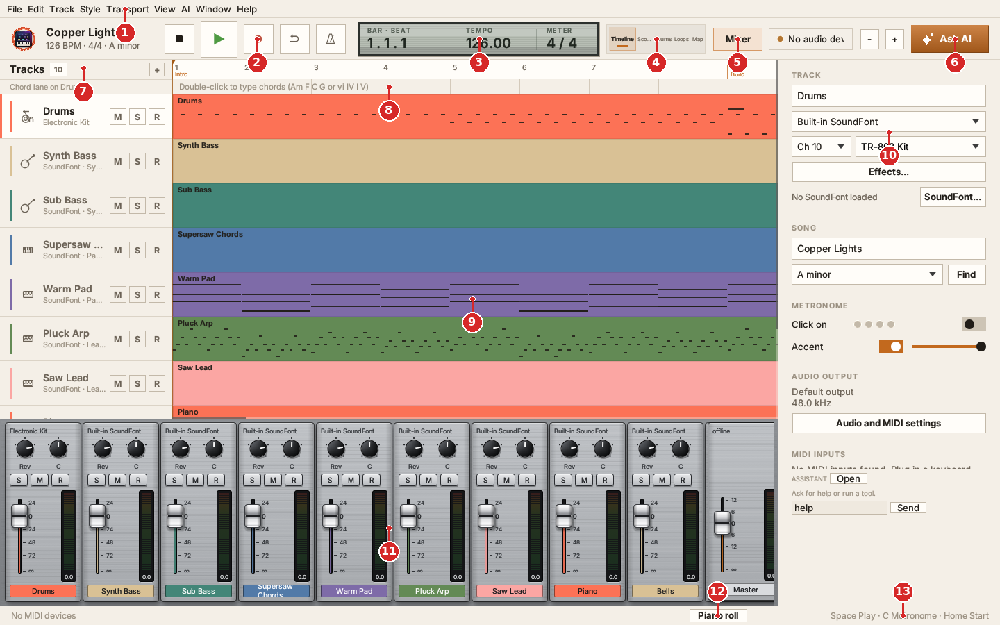
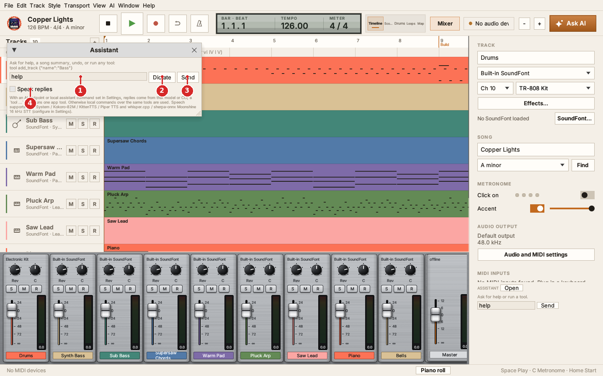
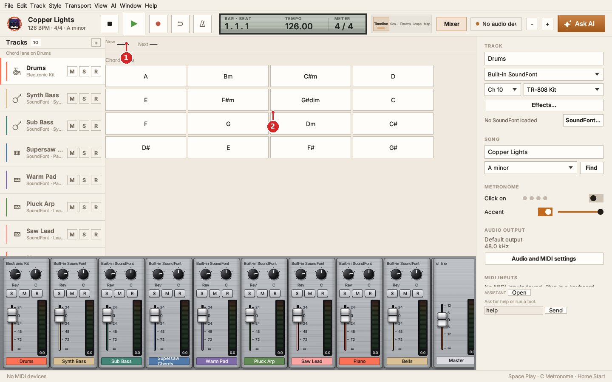
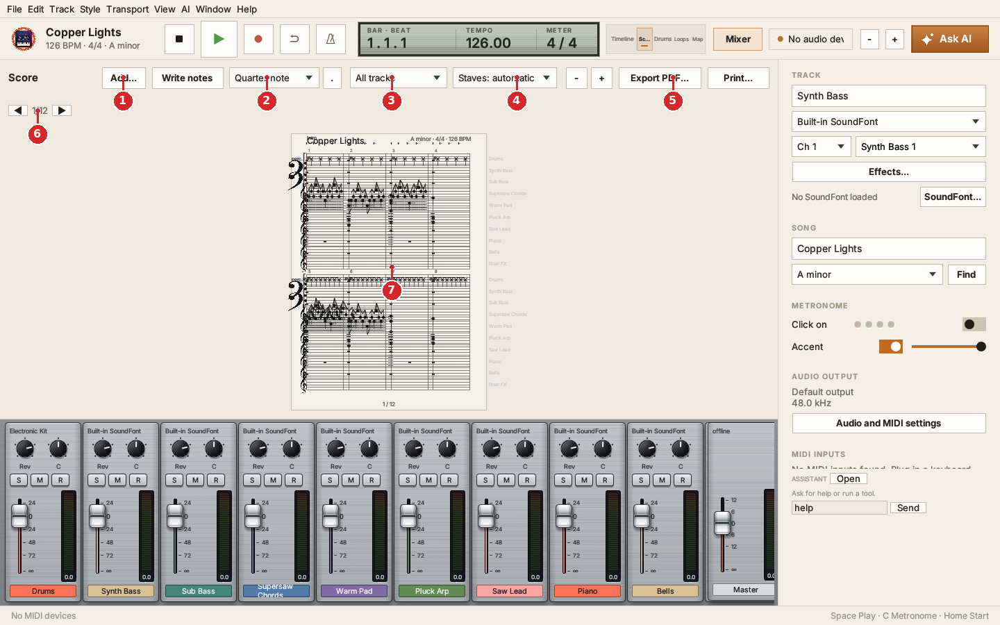
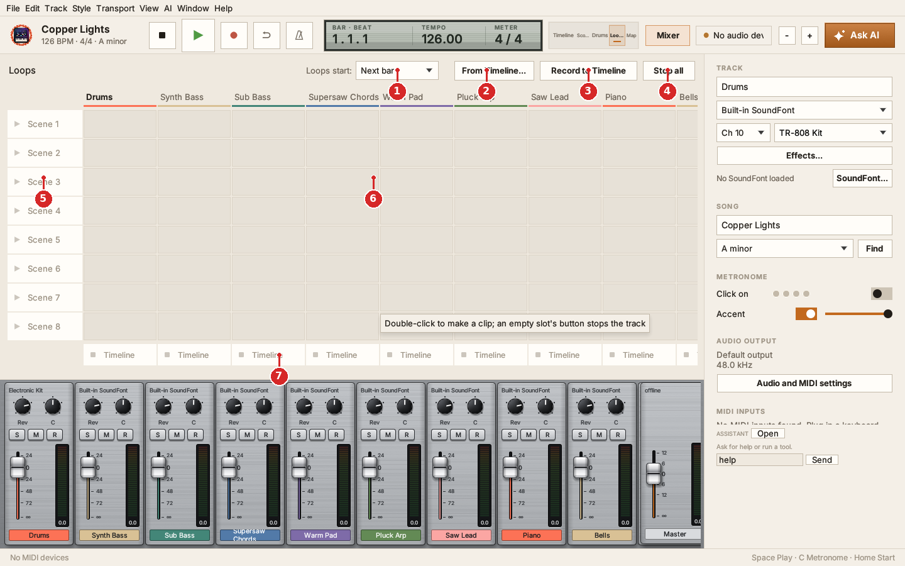
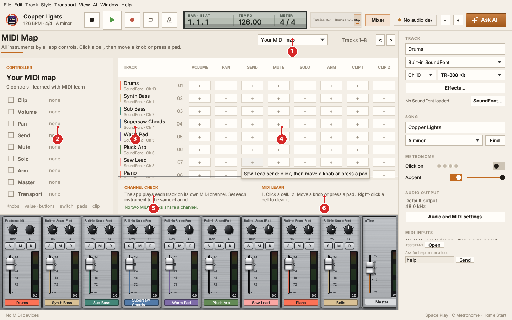
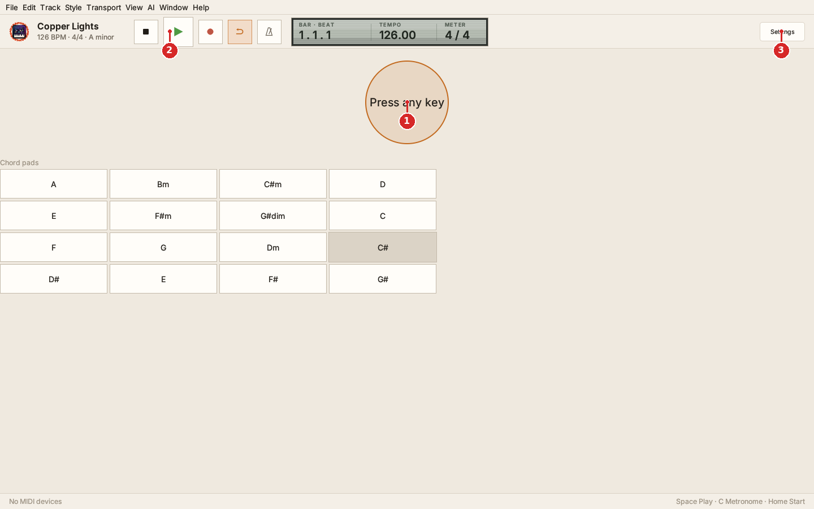

# Lazy Arranger Midi DAW

A desktop studio for people who arrange songs. Write with styles and chords,
let the AI help with the arrangement, print the score, and play it all on your
own keyboards and synths. Native and light, for macOS, Windows and Linux.

This is the new version of Lazy Arranger, rebuilt in Rust. It is a **beta**.

[Download the latest release](https://github.com/nhth-mibu/Lazy-Arranger-v2/releases/latest)
· [User manual](docs/manual/user-manual.md) ([PDF](docs/manual/user-manual.pdf))

## Arranger keyboard styles, on the computer

Open Yamaha styles (`.sty`, `.prs` and the SFF format). Play the sections with
chords, or fill tracks from a style: the parts follow the chords of your song.
Save a new style, or make one from your own clips or from a recording.

When the song is ready, export it for the Yamaha PSR-S970, with programs,
tempo, chords and lyrics, and play it on the keyboard without the computer.

## An AI that works inside your song

Click **Ask AI** and type what you want: "add a bass track", "make the drums
quieter". Each change is one undo step. Use an OpenAI-compatible service (also
a local one, such as Ollama) or a local AI command. Without a service, the
assistant still runs the app commands on your computer. Speak to it and let it
read the answers aloud.

The app is also an MCP server, so Claude Desktop, Claude Code and other MCP
clients can open and change your song from outside the app.

The **AI** menu has music tools too: humanise, drumify, write a bass, pad,
arpeggio or melody part, and continue the last bars.

## Arranging help

- **Arrangement Doctor** finds crowded bars and parts that repeat too much,
  and proposes fixes.
- **Fit to My Synths** checks the song against the note range and polyphony
  of your hardware synths.
- **Groove** puts the feel of one track on the other tracks.
- **Song Forms** makes a short version, a long intro, a gig version or an
  instrumental, with drum fills and lead-ins where sections meet.

Each tool shows its proposal first. Nothing changes until you say so.

## Smart chords

Type `Am F C G` or `vi IV I V` into the chord lane. The app finds the chords
in your notes, reharmonises a bar, and gives you 16 chord pads in the key of
the song.

## A real score

Every song is also printed music: chord symbols, guitar chords, lyrics,
dynamics and drum staves. Write notes with the mouse. Print, or export PDF
and MusicXML.

## Drums, loops and a metal mixer

Program beats in the **Drums** step grid. Play scenes live in the **Loops**
grid, then record them into the song. Mix on a console with knobs, faders,
meters, buses, sends, master effects and VST3 plug-ins (and Audio Units on a
Mac).

## Made for your keyboards and synths

- Plug in a keyboard or a controller and play.
- Choose the instruments that you own at the first start. Editors for the
  Roland D-05, Yamaha PSR-S970, Yamaha XG, Novation XioSynth and Zoom LiveTrak
  L6max. The AI can make a profile for a synth that is not in the list.
- Send sounds and SysEx dumps to your synth from the device editor.
- Connect any controller knob, fader or pad in the **MIDI Map** with MIDI
  Learn.
- Import a multitrack recording from the Zoom LiveTrak L6max.

## Kids Mode

A child presses any key and the song plays, as if the child plays it. Stop
pressing, and the song waits.

## And a full DAW

MIDI and audio tracks, a piano roll with a velocity lane, audio import (WAV,
FLAC, MP3, M4A, AIFF, OGG), recording, automation, SoundFonts, and export to
MIDI, MusicXML, WAV and stems. Eight interface languages, light and dark
themes. It also opens songs from the older C++ version of Lazy Arranger.

## Learn more

- [User manual](docs/manual/user-manual.md) ([PDF](docs/manual/user-manual.pdf)):
  how to use the app, with pictures
- [Changelog](CHANGELOG.md): what changed in each release
- [Building from source](docs/building.md): requirements, build, tests, code
  layout and how to make a release
- [Architecture contracts](docs/architecture/contracts.md) and
  [design decisions (ADRs)](docs/adr/README.md)
- [Feature crosscheck](docs/audit/cpp-features-crosscheck.md): the status of
  each feature compared with the C++ app
- [Hardware tests](docs/audit/hardware.md) and [final status](docs/audit/final-status.md)
- [Licensing and provenance](docs/audit/licensing.md)

Tested with the Yamaha PSR-S970, Roland D-05, Novation Launchkey, Novation
XioSynth, Behringer X-Touch and Zoom LiveTrak L6max. Other models were not
tested.

## Licence

Apache-2.0. Third-party licences are listed in
[licensing and provenance](docs/audit/licensing.md).
