# Lazy Arranger Midi DAW — User Manual

Version 0.1.0-beta.5

This manual tells you how to use Lazy Arranger Midi DAW. It is for musicians,
not programmers. Each picture has red numbers. The list under the picture
tells you what each number is.

The pictures show the light theme with the demo song *Copper Lights*. On your
computer the colours can be dark, and the song can be different.

## Contents

1. [Install the app](#1-install-the-app)
2. [First start: choose your instruments](#2-first-start-choose-your-instruments)
3. [The main window](#3-the-main-window)
4. [Play, record and the metronome](#4-play-record-and-the-metronome)
5. [Tracks and the Timeline](#5-tracks-and-the-timeline)
6. [The piano roll](#6-the-piano-roll)
7. [The Score view](#7-the-score-view)
8. [The Drums view](#8-the-drums-view)
9. [The Loops view](#9-the-loops-view)
10. [The mixer](#10-the-mixer)
11. [The MIDI Map view](#11-the-midi-map-view)
12. [Chord pads (Perform)](#12-chord-pads-perform)
13. [The AI assistant](#13-the-ai-assistant)
14. [Instrument editors](#14-instrument-editors)
15. [Kids Mode](#15-kids-mode)
16. [Settings](#16-settings)
17. [Files: open, save, import and export](#17-files-open-save-import-and-export)
18. [Keyboard shortcuts](#18-keyboard-shortcuts)
19. [Problems and answers](#19-problems-and-answers)

---

## 1. Install the app

Get the file for your computer from the
[Releases page](https://github.com/nhth-mibu/Lazy-Arranger-v2/releases).

| Computer | File | What to do |
| --- | --- | --- |
| Mac (macOS 12 or newer, Apple Silicon or Intel) | `…-macos-universal.dmg` | Open the file. Drag **Lazy Arranger Midi DAW** to **Applications**. |
| Windows 10 or 11 (64-bit) | `…-windows-x64.zip` | Unzip the folder. Open **Lazy Arranger Midi DAW.exe**. |
| Linux (64-bit) | `…-linux-x64.tar.gz` | Extract the folder. Run `./lazy-arranger-desktop`. Run `./install.sh` one time to add the app to your app menu. |

**The first start on a Mac.** The app is not notarized by Apple. macOS can
say that it cannot check the app. Right-click the app and choose **Open**.
Then click **Open** again. You do this one time only.

**The first start on Windows.** The app is not code-signed. If Windows
SmartScreen shows a warning, click **More info**, then **Run anyway**.

**Linux.** The app needs ALSA (`libasound2`) and a graphics driver for
Vulkan or OpenGL. Most desktop Linux systems have them.

---

## 2. First start: choose your instruments

The first time you start the app, it asks which instruments you have.

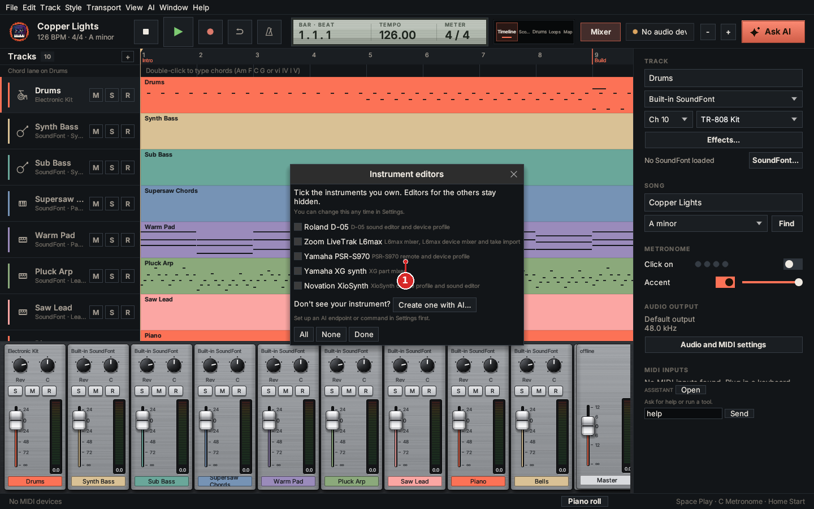

1. **The instrument list.** Tick each instrument that you own. The app shows
   the editors and mixers for these instruments only. The others stay hidden.

You can choose **All**, **None**, or tick the boxes one by one. Click
**Done** when you are ready. You can change this later in
[Settings](#16-settings).

If your instrument is not in the list, see
[Instrument editors](#14-instrument-editors).

---

## 3. The main window

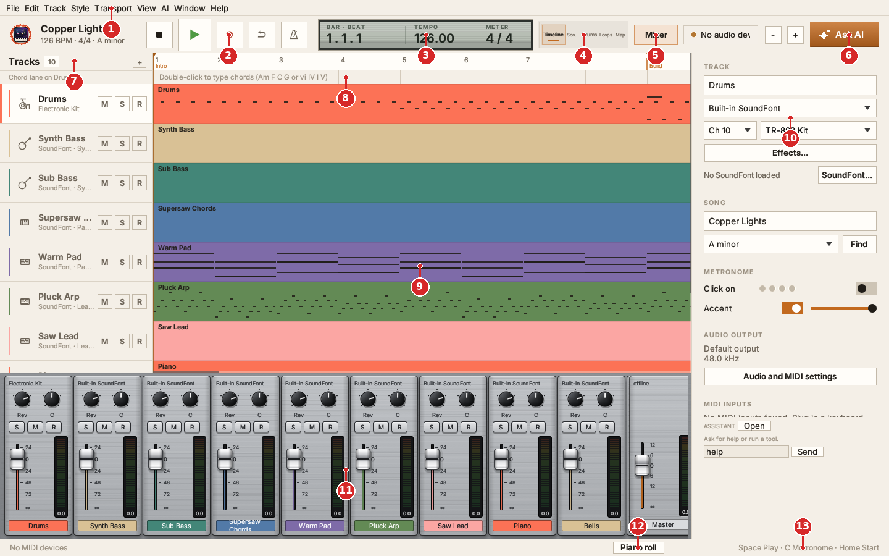

1. **Menu bar.** All commands: File, Edit, Track, Style, Transport, View, AI,
   Window and Help. On a Mac, the menus are in the macOS menu bar at the top
   of the screen.
2. **Transport buttons.** Stop, Play, Record, Loop and Metronome.
3. **Position display.** Bar and beat, tempo and meter. Drag or
   double-click the tempo to change it. Click the meter to choose a time
   signature.
4. **View tabs.** Timeline, Score, Drums, Loops and MIDI Map.
5. **Mixer button.** Shows or hides the mixer at the bottom.
6. **Ask AI.** Opens the [AI assistant](#13-the-ai-assistant).
7. **Track list.** One row for each track, with Mute (**M**), Solo (**S**)
   and Record arm (**R**). Click **+** to add a track.
8. **Chord lane.** The chords of the song. Double-click to type chords, for
   example `Am F C G` or `vi IV I V`.
9. **Timeline.** The parts of each track, in bars. The ruler at the top shows
   the bar numbers and the section markers (for example *Intro* and *Build*).
10. **Inspector.** The settings of the selected track (name, sound, MIDI
    channel, program, effects), the song (name, key) and the metronome.
11. **Mixer.** One channel strip for each track. See [The mixer](#10-the-mixer).
12. **Piano roll button.** Opens the note editor for the selected track.
13. **Status bar.** Messages from the app, and the most important keys.

---

## 4. Play, record and the metronome

| To do this | Do this |
| --- | --- |
| Play or pause | Press **Space**, or click the Play button. |
| Stop | Click the Stop button. |
| Go to the start | Press **Home**. |
| Loop a part of the song | Click the Loop button. |
| Turn the click on or off | Press **C**, or click the Metronome button. |
| Record MIDI | Click **R** on a track to arm it. Click Record. Play your MIDI keyboard. |

The metronome settings are in the inspector (**Click on**, **Accent** and the
level). The app can count in before it records. You set this in
[Settings](#16-settings).

When you record, you can let the app quantise the notes to 1/16 and find the
chords that you play. These are also in Settings.

---

## 5. Tracks and the Timeline

**Add a track.** Click **+** above the track list, or use **Track > Add
Track**.

**Change a track.** Select the track. Use the inspector at the right:

- The **name** of the track.
- The **sound**: the built-in sounds, a SoundFont (`.sf2`) that you load with
  **SoundFont…**, or a MIDI output to a hardware synth.
- The **MIDI channel** and the **program** (the instrument sound).
- **Effects…** for plug-ins and the track effects.

**Other track commands** are in the **Track** menu, and in the menu that
opens when you right-click a track: Duplicate, Move Up, Move Down and Delete.

**Parts on the Timeline.** Right-click a part for the part commands: cut,
copy, paste, duplicate, split at the playhead, join with the next part,
quantise, edit notes and delete. Audio parts also have fade in, fade out,
gain, normalise and takes. Each change is one undo step.
Press **Ctrl+Z** (Windows, Linux) or **Cmd+Z** (Mac) to undo.

**Chords.** Double-click the chord lane and type the chords. The app knows
chord names (`Am7`, `F/C`) and roman numerals in the song key (`vi IV I V`).
Press **F** to find the chords from the notes in the song. Press **H** to
reharmonise the chord at the playhead.

**Arranging help** (in the **AI** menu or with one key in the Timeline):

| Key | Tool | What it does |
| --- | --- | --- |
| **D** | Arrangement Doctor | Finds crowded bars and parts that repeat too much, and proposes fixes. |
| **G** | Groove | Puts the feel of one track on the other tracks. |
| **Y** | Song Form | Makes a short, long-intro, gig or instrumental version of the song. |
| **T** | Transition | Adds a drum fill or a lead-in where two sections meet. |

Each tool shows its proposal first. Nothing changes until you accept it.

---

## 6. The piano roll

Select a track and click **Piano roll** at the bottom of the window.

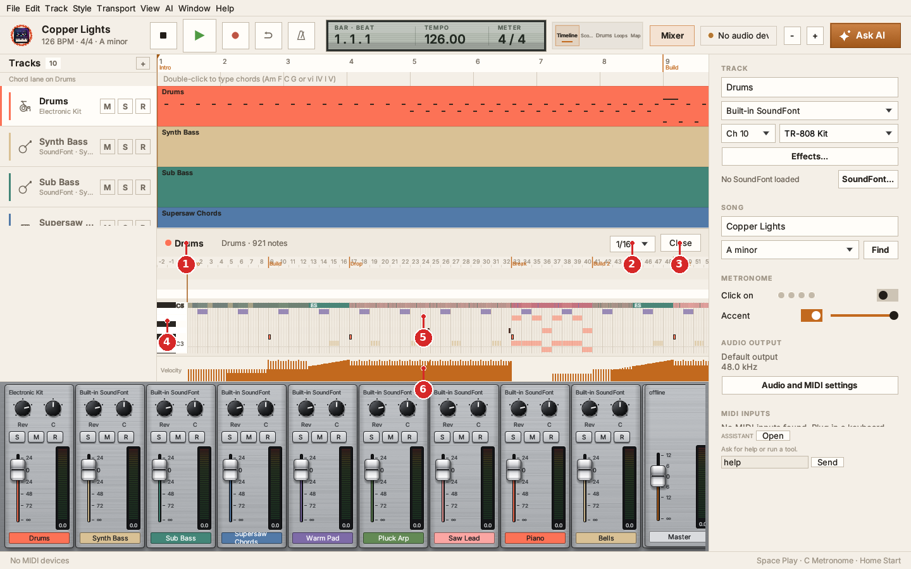

1. **Track name and note count.** The track that you edit.
2. **Grid.** The note length for new notes and for the snap (for example
   1/16).
3. **Close.** Closes the piano roll.
4. **Piano keys.** Click a key to hear the note.
5. **Notes.** Click to add a note. Drag a note to move it. Drag the end of a
   note to change its length. Press **Delete** to remove the selected notes.
6. **Velocity lane.** The height of each bar is how loud the note is. Drag a
   bar to change it.

Right-click in the piano roll for more commands: cut, copy, paste, select
all, quantise to 1/16, delete, and add a chord symbol, lyrics or dynamics.

---

## 7. The Score view

Click **Score** in the view tabs, or press **Ctrl/Cmd+3**.

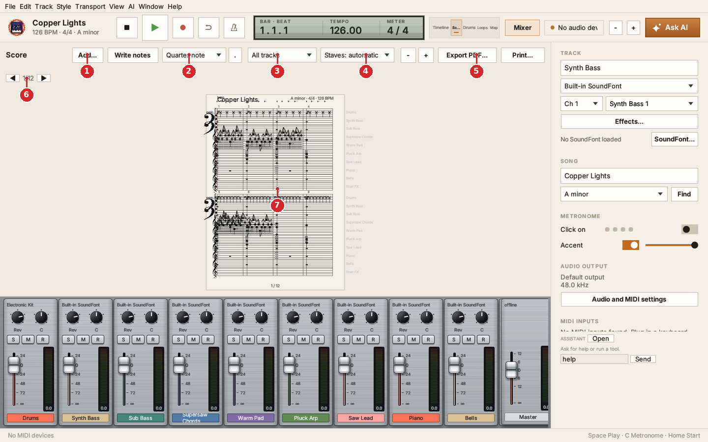

1. **Add…** Adds lyrics or a mark at the selected note.
2. **Note value.** The length of the next note when you write notes. Click
   **Write notes** first.
3. **Tracks.** Show all tracks, or one track only.
4. **Staves.** Choose the staves automatically, or a grand staff, or a drum
   staff.
5. **Export PDF…** Saves the score as a PDF file. **Print…** prints it.
6. **Pages.** Go to the previous or the next page.
7. **The page.** Click a bar to move the playhead there. The page follows the
   playhead when the song plays.

The score shows chord symbols, guitar chord frames, lyrics and the section
markers. The editable score shows one track at a time. All tracks together
are a read-only view.

---

## 8. The Drums view

Click **Drums** in the view tabs, or press **Ctrl/Cmd+4**. Press **B** in the
Timeline to open the beat grid of the selected bar.

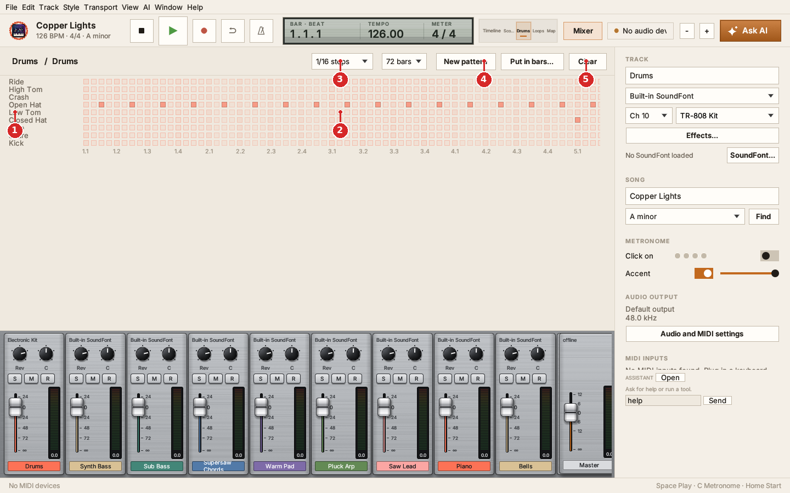

1. **Drum sounds.** One row for each sound: kick, snare, hi-hats, toms,
   cymbals.
2. **Step grid.** Click a step to add a hit. Click again to make it soft,
   normal or loud. Click one more time to remove it.
3. **Steps and bars.** The step size (for example 1/16) and the length of the
   pattern.
4. **New pattern** starts an empty pattern. **Put in bars…** copies the
   pattern into the bars that you choose.
5. **Clear.** Removes all hits from the pattern.

---

## 9. The Loops view

Click **Loops** in the view tabs, or press **Ctrl/Cmd+5**. The Loops view is
a grid of clips for live play. Each row is a scene. Each column is a track.

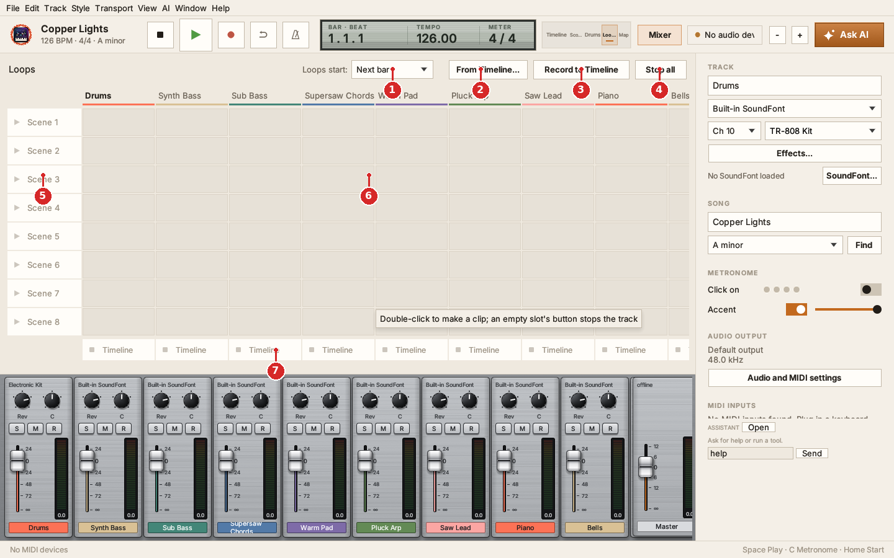

1. **Loops start.** When a clip starts after you click it: on the next bar,
   or after the next 2 or 4 bars.
2. **From Timeline…** Fills the scenes from parts of the song.
3. **Record to Timeline.** Records what you play in the grid into the song.
4. **Stop all.** Stops all clips at the next bar.
5. **Scenes.** Click a scene name to start all clips in that row.
   Double-click it to rename the scene.
6. **Slots.** Double-click an empty slot to make a clip. Click the play
   button of a clip to start or stop it. The button of an empty slot stops
   its track. Right-click a clip for more commands.
7. **Timeline buttons.** Each track goes back to playing the song Timeline.

Double-click a clip to edit its notes in the piano roll.

---

## 10. The mixer

Click **Mixer** at the top of the window, or press **Ctrl/Cmd+2**.

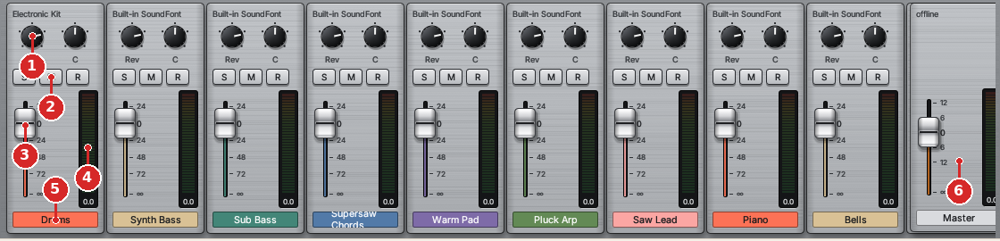

1. **Reverb and chorus.** Turn the knobs to send more of the track to the
   reverb (**Rev**) and the chorus (**C**).
2. **Solo, Mute and Record arm** (**S**, **M**, **R**).
3. **Fader.** The level of the track in dB.
4. **Meter.** How loud the track plays now.
5. **Track name.** Right-click for more commands: rename, the output (master
   or a bus), the send bus, and the effects and plug-ins of the track.
6. **Master.** The level of the whole song.

The **Window** menu has more mixing tools: **Master Effects** (limiter,
reverb and chorus on the whole song), **Bus Effects** and **Plugins** (VST3,
and Audio Units on a Mac).

---

## 11. The MIDI Map view

Click **Map** in the view tabs, or press **Ctrl/Cmd+6**. Here you connect the
knobs, faders and pads of a MIDI controller to the app.

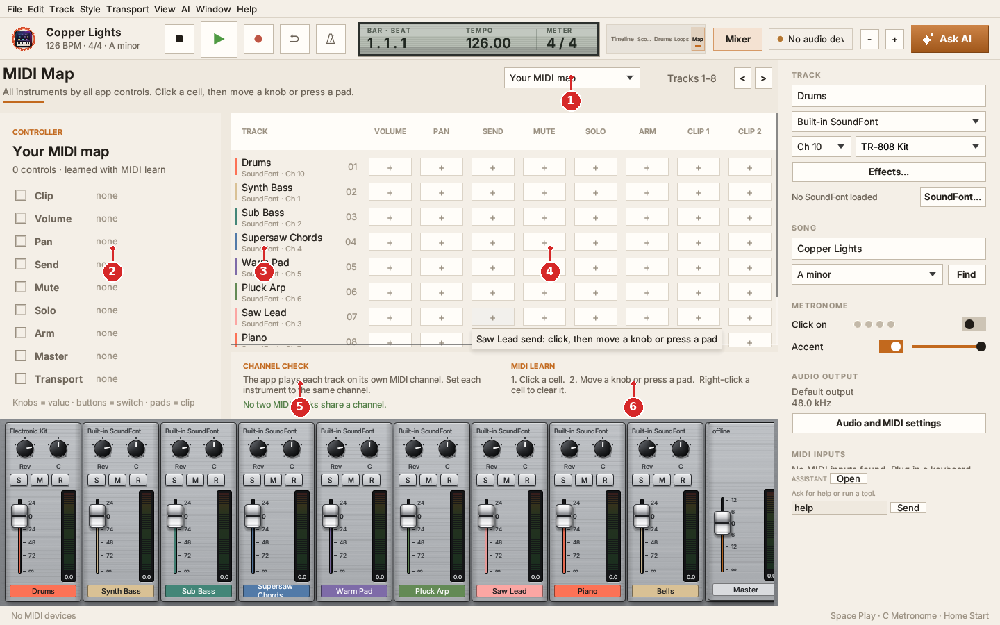

1. **Map.** Choose a saved map, or **Your MIDI map**.
2. **Controller controls.** The kinds of control that the map uses: clip,
   volume, pan, send, mute, solo, arm, master and transport.
3. **Tracks.** One row for each track, with its sound and MIDI channel.
4. **Map grid.** Click a cell, then move a knob or press a pad on the
   controller. The app learns that control for that cell.
5. **Channel check.** Tells you if two MIDI tracks use the same channel.
6. **MIDI learn.** How to learn a control. Right-click a cell to clear it.

Knobs set a value, buttons switch something on or off, and pads start a clip.

---

## 12. Chord pads (Perform)

Press **K** in the Timeline, or use **View > Perform**.

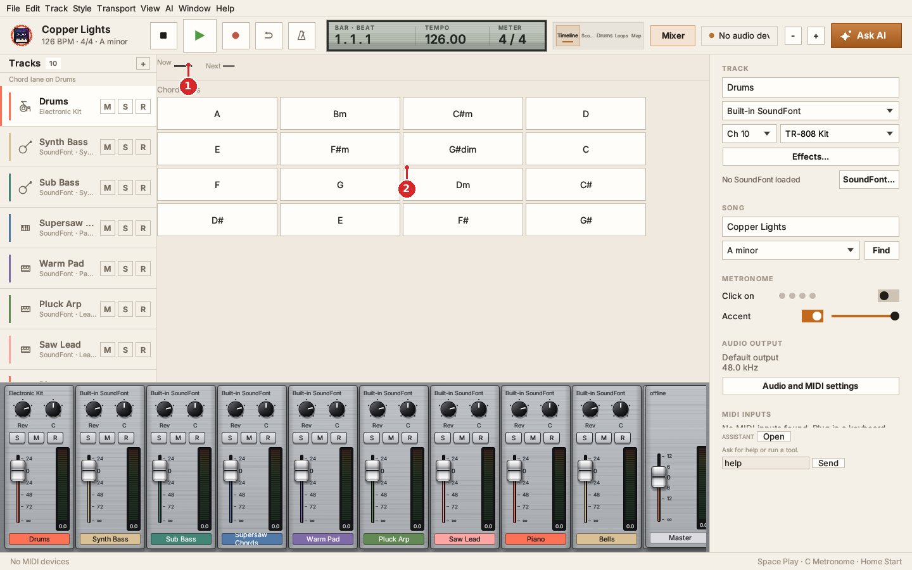

1. **Now and Next.** The chord that plays now, and the next chord.
2. **Chord pads.** Sixteen chords that fit the key of the song. Click a pad
   to play the chord.

---

## 13. The AI assistant

Click **Ask AI**, or use **AI > Assistant…**.

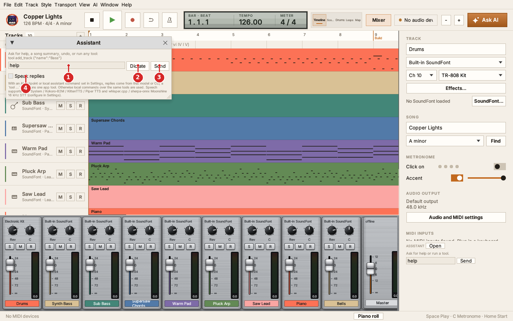

1. **Ask.** Type what you want, for example *help*, *add a bass track* or
   *make the drums quieter*. Then press **Enter** or click **Send**.
2. **Dictate.** Speak your question. This needs a speech model on your
   computer (see [Settings](#16-settings)).
3. **Send.** Sends the question.
4. **Speak replies.** The app reads the answer aloud.

Each change that the assistant makes is one undo step. Press **Ctrl/Cmd+Z**
to undo it.

**Without an AI service** the assistant runs on your computer. It knows the
commands of the app (type *help* to see them).

**With an AI service** the assistant understands normal sentences. In
Settings, type the address of an OpenAI-compatible service (for example a
local Ollama server) and your key, or a command for a local AI tool.

The **AI** menu also has music tools that work without an AI service:
**Humanise**, **Drumify**, **Write a Bass Part**, **Write a Pad Part**,
**Write an Arpeggio**, **Continue 4 Bars** and **Write a Melody**.

**AI and other programs.** The app is also an MCP server. Claude Desktop,
Claude Code and other MCP clients can open and change your song from outside
the app.

---

## 14. Instrument editors

Use **Window > Instrument Editors…** to choose which instrument editors you
see.

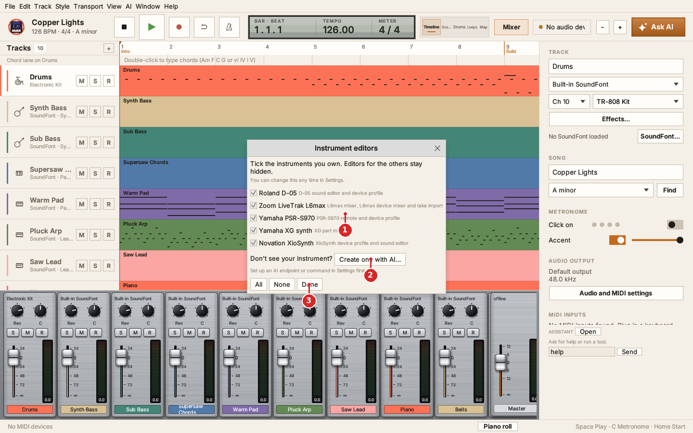

1. **Instruments.** Roland D-05, Zoom LiveTrak L6max, Yamaha PSR-S970,
   Yamaha XG synths and Novation XioSynth. Tick the ones that you own.
2. **Create one with AI…** If your instrument is not in the list, the AI can
   make a device profile from its MIDI chart. You need an AI service in
   Settings for this.
3. **Done.** Saves your choice.

**The device editor** (**Track > Device Editor…**) sends sounds and settings
to a hardware synth.

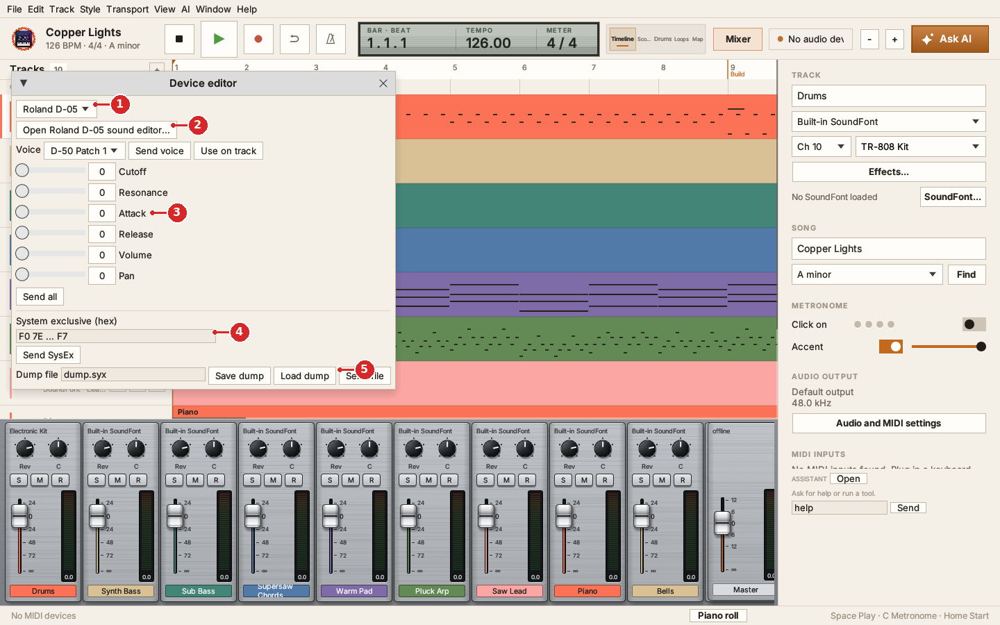

1. **Device.** Choose the synth.
2. **Sound editor.** Opens the full sound editor of the synth, for example
   the Roland D-05 editor.
3. **Sound controls.** Cutoff, resonance, attack, release, volume and pan.
   Click **Send all** to send all values to the synth.
4. **System exclusive.** Type a SysEx message in hex (`F0 … F7`) and click
   **Send SysEx**.
5. **Dump file.** Save the synth settings to a `.syx` file, load a file, or
   send a file to the synth.

---

## 15. Kids Mode

Kids Mode lets a child play the song. The child presses any key and the song
plays. When the child stops, the song waits.

Turn it on with **Transport > Kids Mode** or **Ctrl/Cmd+Alt+K**.

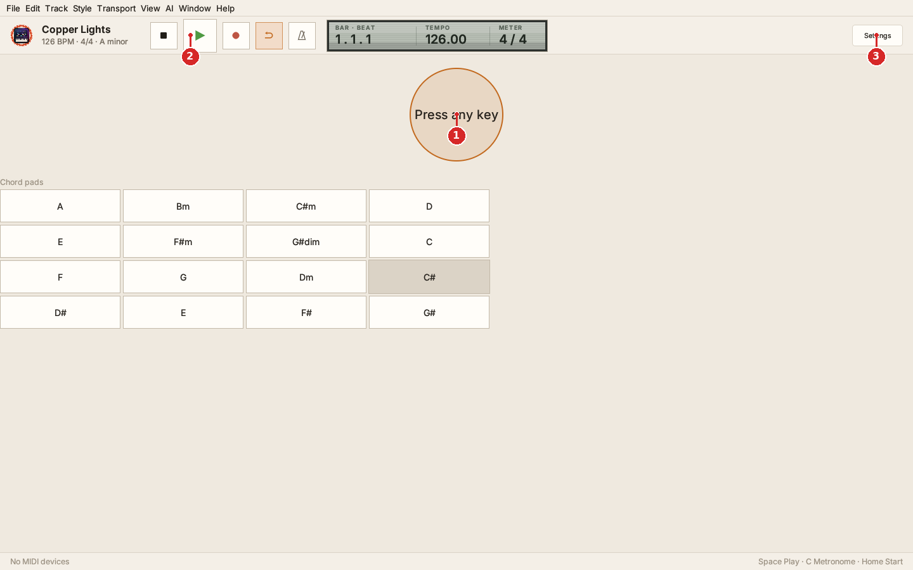

1. **Press any key.** The big circle. It shows that the app waits for a key.
2. **Transport.** Play, stop and the song position.
3. **Settings.** Only an adult needs this button. Turn Kids Mode off in
   Settings.

---

## 16. Settings

Open Settings with **File > Settings…** or **Ctrl/Cmd+,**.

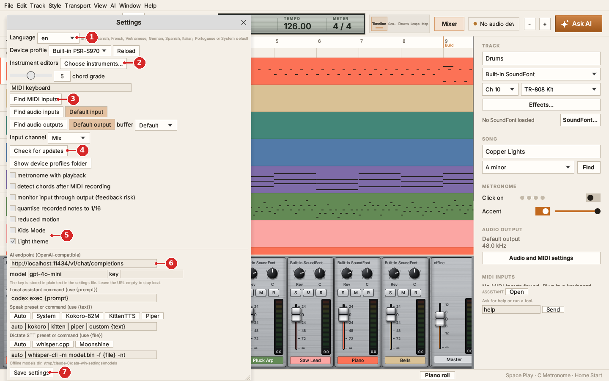

1. **Language.** English, Danish, French, Vietnamese, German, Spanish,
   Italian, Portuguese, or the language of your computer.
2. **Instrument editors.** Choose the instruments that you own.
3. **MIDI and audio.** Find MIDI inputs, audio inputs and audio outputs.
   Choose the input channel and the audio buffer size.
4. **Check for updates.** Tells you when a new version is on the Releases
   page.
5. **Options.** Metronome with playback, find chords after recording,
   monitor the input, quantise to 1/16, reduced motion, **Kids Mode** and
   **Light theme**.
6. **AI.** The address, model and key of an AI service, a local AI command,
   and the speech presets (read aloud and dictate).
7. **Save settings.** Saves your changes.

The AI key is stored as plain text in the settings file on your computer.
Leave the address empty to keep everything on your computer.

---

## 17. Files: open, save, import and export

Use the **File** menu.

| Command | What it does |
| --- | --- |
| **New**, **Open…**, **Open Recent** | Start a song, or open a song. |
| **Save**, **Save As…** | Save the song as a `.arranger` file. |
| **Import Audio File…** | Add a WAV, FLAC, MP3, M4A, AIFF or OGG file as an audio track. |
| **Import L6max Recording…** | Add the tracks of a Zoom LiveTrak L6max recording. |
| **Export MIDI File…** | Save a standard MIDI file. |
| **Export MusicXML File…** | Save the score for other notation programs. |
| **Export Audio File…** | Save the song as a WAV file. |
| **Export Stems…** | Save one audio file for each track. |

**Files you can open:** Lazy Arranger songs (`.arranger`, also from the
older C++ app), MIDI files (`.mid`, `.midi`) and MusicXML (`.musicxml`,
`.xml`). Yamaha styles (`.sty`, `.prs` and the SFF format) open from the
**Style** menu.

**Autosave.** The app saves a copy of your song while you work. If the app
stops by accident, it offers the copy the next time it starts.

---

## 18. Keyboard shortcuts

On a Mac, use **Cmd**. On Windows and Linux, use **Ctrl**. Press **F1** to see
all shortcuts in the app.

| Key | Action |
| --- | --- |
| **Space** | Play or pause |
| **Home** | Go to the start |
| **C** | Metronome on or off |
| **Ctrl/Cmd+P** | Play or pause |
| **Ctrl/Cmd+N**, **O**, **S** | New, open, save |
| **Ctrl/Cmd+Shift+S** | Save as |
| **Ctrl/Cmd+Z**, **Ctrl/Cmd+Shift+Z** | Undo, redo |
| **Ctrl/Cmd+1** to **6** | Timeline, mixer, Score, Drums, Loops, MIDI Map |
| **Ctrl/Cmd+,** | Settings |
| **Ctrl/Cmd+Alt+K** | Kids Mode |
| **F1** | Keyboard shortcuts |

In the Timeline:

| Key | Action |
| --- | --- |
| **M**, **S** | Mute, solo the selected track |
| **B** | Beat grid |
| **K** | Chord pads |
| **F** | Find chords |
| **H** | Reharmonise |
| **D** | Arrangement Doctor |
| **G** | Groove |
| **Y** | Song Form |
| **T** | Transition |

---

## 19. Problems and answers

**I hear no sound.**
Look at the top of the window. If it says *No audio device*, open
**Settings** and click **Find audio outputs**. Choose your speakers or
headphones.

**My MIDI keyboard does nothing.**
Connect the keyboard before you start the app, or click **Find MIDI inputs**
in Settings. The status bar at the bottom shows the MIDI devices that the app
found.

**A hardware synth plays the wrong sounds.**
Open the [MIDI Map view](#11-the-midi-map-view) and look at the channel
check. Each track must use its own MIDI channel. Then choose the correct
device profile in Settings.

**The Mac says the app is damaged or cannot be checked.**
Right-click the app, choose **Open**, then click **Open** again. See
[Install the app](#1-install-the-app).

**I want to report a problem.**
Open an issue on the
[project page](https://github.com/nhth-mibu/Lazy-Arranger-v2/issues). Tell us
your computer, the app version (**Help > About**) and the steps that cause
the problem.

This is a beta version. Some features of the older C++ app are not complete
yet. The [feature crosscheck](../audit/cpp-features-crosscheck.md) lists the
status of each feature.
